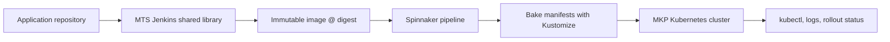

# MTS Application ToolSuite Demos

Welcome to the hands-on MTS Labs learning collection. These pages are designed to be copied into **Outline** as Markdown and used by developers, operators, and platform administrators.

> [!TIP]
> Replace values labeled `REPLACE_WITH_*` with values supplied by your MTS administrator. The demos intentionally do not embed credentials.

## Are the example folders part of Outline?

No. The files under [docs](docs/) are pages to import into Outline. The folders under [examples](examples/) are downloadable starter kits for developers.

For an application such as FastAPI:

1. Copy the contents of [examples/python-fastapi](examples/python-fastapi/) into a **new, separate Git repository**.
2. Keep `Jenkinsfile`, `pipeline.yml`, and `Dockerfile` at the repository root.
3. Update `app` in `pipeline.yml`; keep `project: demo` for this learning project space.
4. Commit and configure the new repository as a Jenkins Pipeline or Multibranch Pipeline.
5. Do not import the starter source code into the Outline page. Link to or attach the example repository instead.

The tagged [Jenkinsfile](examples/python-fastapi/Jenkinsfile) is therefore a real pipeline entry point. Jenkins reads it from the root of the FastAPI repository, loads `mts-jenkins-lib`, reads that repository's `pipeline.yml`, and performs the selected build.

### Browser IDE pages

Each starter also has a self-contained page under [docs/code-browser](docs/code-browser/). The page contains:

- a visual file tree;
- collapsible `<details>` panels;
- the complete content of every file;
- the exact path where each copied file belongs.

After changing an example, regenerate the browser pages:

```bash
python scripts/generate_code_browsers.py
```

The browser pages are fully self-contained. Readers copy a code block and save it at the displayed path. Repository or ZIP download links can be added later without changing the embedded source.

## Learning paths

| Path | Goal | Pages |
|---|---|---|
| 🚀 Platform start | Understand the MTS application-delivery flow | [Platform overview](docs/00-platform-overview.md) |
| 🔑 MKP access | Connect VPN, configure kubeconfig, authenticate | [Access and OIDC](docs/12-mkp-access-oidc.md) |
| ☸️ Kubernetes | Switch contexts, inspect workloads, deploy NGINX | [Contexts](docs/01-kubernetes-contexts.md), [NGINX](docs/02-nginx-static-site.md) |
| 🌐 Networking | Publish applications through MTS DNS and ingress | [DNS and ingress](docs/13-mkp-dns-ingress.md) |
| 🔐 Authorization | Understand OIDC, RBAC, and secret safety | [Security and RBAC](docs/14-mkp-security-rbac.md) |
| 🛠️ Pipeline operations | Diagnose Jenkins and trace digest handoff to Spinnaker | [Jenkins troubleshooting](docs/15-jenkins-troubleshooting.md), [Spinnaker handoff](docs/16-spinnaker-image-handoff.md) |
| 📊 Operations | Inspect health, logs, events, and rollout state | [Observability](docs/17-mkp-observability.md) |
| 💾 Reliability | Understand persistence, backups, and recovery ownership | [Storage and backup](docs/18-mkp-storage-backup.md) |
| ✅ Release readiness | Validate an application before an MKP deployment | [Release checklist](docs/19-mkp-release-checklist.md) |
| 🧰 Jenkins | Build Java, Python, generic, and Node images | [Jenkins guide](docs/03-jenkins-getting-started.md) and stack demos |
| 🚢 Spinnaker | Bake Kustomize manifests and deploy to Kubernetes | [Spinnaker guide](docs/08-spinnaker-kubernetes.md) |
| 🗄️ Data services | Provision PostgreSQL and Redis with KubeBlocks | [Database guide](docs/09-kubeblocks-databases.md), [Redis guide](docs/10-kubeblocks-redis.md) |
| 🪣 Object storage | Provision MinIO and create multiple buckets | [MinIO guide](docs/11-kubeblocks-minio.md) |

## Delivery flow



## Demo conventions

- **Jenkins project:** `demo`
- **Example Spinnaker application:** `demo`
- **Kubernetes namespace parameter:** `demo`
- **Application names:** `demo-spring`, `demo-fastapi`, `demo-image`, `demo-node`
- **Production-like branch:** `master`
- **Development branch:** `develop`
- **Image reference:** use the digest written to `imageRef.properties`, not a manually guessed tag

## Reference implementations

The examples follow locally implemented MTS patterns from:

- `bridge-api-gateway` for Jenkins shared-library usage, `pipeline.yml`, Docker, and branch-to-pipeline mapping
- `mts-labs-deployment-configs` for Spinnaker baking, Kustomize substitutions, PostgreSQL, Redis, and MinIO KubeBlocks clusters
- `mts-s3` for MinIO resource selectors and ingress patterns
- `mts-jenkins-lib`, located under `spotme-web`, for supported stacks and stage behavior
- the MKP developer documents for VPN, OIDC, MicroK8s, cluster naming, DNS, ingress, and RBAC

## Copying a sample

1. Open a directory under [examples](examples/).
2. Copy its files to a new application repository.
3. Read the matching page under [docs](docs/).
4. Replace administrator-owned values.
5. Commit, create a Jenkins job, and run it.

## Platform safety

- Never commit passwords, tokens, private keys, or kubeconfigs.
- Treat `DoNotTerminate` database policies as destructive-operation protection, not a backup strategy.
- Confirm the cluster's StorageClass, KubeBlocks component definitions, ingress class, registry hosts, and Jenkins credential IDs.
- KubeBlocks demos use the shared MTS StorageClass `truenas-nfs`.
- Test in a development namespace before production.

