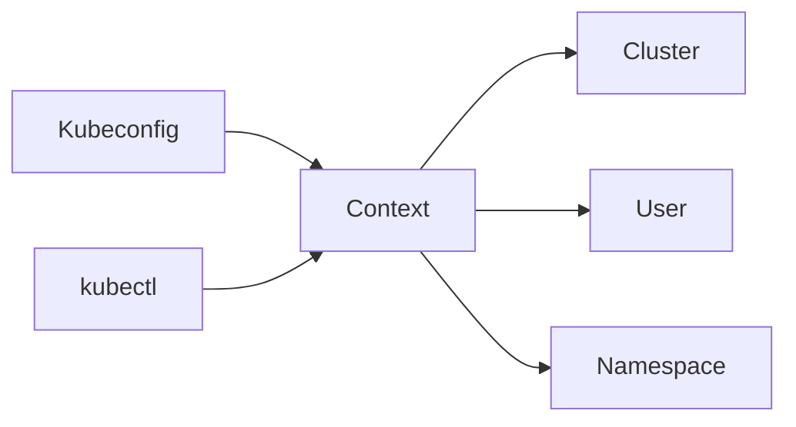

# ☸️ Kubernetes: contexts, namespaces, and deployments

Welcome to MKP! This page gives you a safe daily workflow for selecting a cluster, selecting a namespace, and inspecting workloads.

> [!IMPORTANT]
> Connect to the MTS Lab WireGuard VPN before using MKP. Cluster API and OIDC issuer names resolve on the private MTS network.

## The mental model



A context does not create a namespace or a deployment. It only tells `kubectl` which destination and identity to use by default.

## MTS access prerequisites

1. Use an active FreeIPA/MTS account.
2. Install `kubectl`, Git, Krew, and `kubectl oidc-login`—not the unrelated Azure `kubelogin`.
3. Save the supplied `kubectl-config` as `~/.kube/config`, or set `KUBECONFIG`.
4. Connect to the MTS Lab VPN.
5. Use one of the supplied contexts:
   - `mkp-d1-c01`, `mkp-d1-c02` — development
   - `mkp-t1-c01`, `mkp-t1-c02` — test
   - `mkp-p1-c01`, `mkp-p1-c02` — production

The Kubernetes API uses port `16443`, for example:

```text
https://mkp-d1-c01.magus.lab:16443
```

## 1. Inspect available contexts

```bash
kubectl config get-contexts
kubectl config current-context
```

List clusters and users:

```bash
kubectl config get-clusters
kubectl config get-users
```

> [!CAUTION]
> Use only kubeconfigs issued by the MTS administrator. Do not paste a kubeconfig or authentication token into documentation, tickets, or chat.

## 2. Switch between clusters

```bash
kubectl config use-context REPLACE_WITH_CONTEXT
```

For a normal first connection:

```bash
kubectl config use-context mkp-d1-c01
kubectl auth whoami
kubectl auth can-i create pods --namespace demo
```

The first protected request invokes `kubectl oidc-login`, opens Authentik, and caches the returned token.

Verify the destination before changing anything:

```bash
kubectl cluster-info
kubectl get namespaces
```

## 3. Select a namespace

Change the current context's default namespace:

```bash
kubectl config set-context --current --namespace=demo
kubectl config view --minify | sed -n '/namespace:/p'
```

Or pass the namespace for each command:

```bash
kubectl -n demo get pods
```

Prefer `-n` in automation and runbooks because it makes the destination visible.

## 4. Check deployments

```bash
kubectl -n demo get deploy,sts,ds,po,svc,ingress
kubectl -n demo get deployment demo-node -o wide
kubectl -n demo rollout status deployment/demo-node --timeout=180s
kubectl -n demo describe deployment demo-node
kubectl -n demo describe pod -l app=demo-node
```

Watch changes live:

```bash
kubectl -n demo get pods -w
```

## 5. Check events and logs

```bash
kubectl -n demo get events --sort-by=.lastTimestamp
kubectl -n demo logs deployment/demo-node --tail=100
kubectl -n demo logs -l app=demo-node --all-containers --tail=100
kubectl -n demo logs -l app=demo-node -f
```

For a restarted container:

```bash
kubectl -n demo logs demo-node-REPLACE_WITH_POD_ID -c demo-node --previous
```

## 6. Preview before applying

```bash
kubectl apply --dry-run=client -f deployment.yml
kubectl apply --dry-run=server -f deployment.yml
kubectl diff -f deployment.yml
```

## 7. A safe end-to-end check

```bash
CONTEXT=REPLACE_WITH_CONTEXT
NAMESPACE=demo

kubectl config use-context "$CONTEXT"
kubectl cluster-info
kubectl -n "$NAMESPACE" get deploy
kubectl -n "$NAMESPACE" get events --sort-by=.lastTimestamp | tail -20
```

## Common mistakes

| Symptom | Likely cause | Check |
|---|---|---|
| `NotFound` for an existing service | Wrong context or namespace | `kubectl config current-context` |
| Pods stay `Pending` | No matching storage, CPU, memory, or node | `kubectl describe pod <name>` |
| `ImagePullBackOff` | Registry address, auth, tag, or digest | Pod events and `imagePullSecrets` |
| Service is empty | Selector does not match pod labels | `kubectl get endpoints <service>` |
| Deployment is not ready | Probe or application startup failure | `rollout status`, describe, logs |

## Topic Q&A

### 1. What does a context contain?
A cluster, user/credential configuration, and optional namespace.

### 2. Should I create many contexts for namespace changes?
Not necessarily. Explicit `kubectl -n <namespace>` commands are easier to audit.

### 3. Does changing context create a namespace?
No. It only changes the default destination for later commands.

### 4. How do I preview a write?
Use `--dry-run=server`, `kubectl diff`, and then `apply`.

### 5. Can read access imply write access?
No. RBAC authorizes each verb and resource independently.

## MTS Labs Q&A

### 1. Which identity provider signs me in?
The kubeconfig invokes `kubectl oidc-login`, which authenticates through Authentik.

### 2. Where does the MTS user account come from?
MTS users and groups are maintained in FreeIPA.

### 3. Why does the default context point to development?
The supplied config defaults to `mkp-d1-c01` so a first workflow targets the primary development cluster.

### 4. Which contexts are production?
`mkp-p1-c01` and `mkp-p1-c02`; production deployment should use approved Spinnaker gates.

### 5. Why are cluster endpoints under `magus.lab`?
They are internal MTS FQDNs resolved through VPN-provided routing and DNS, distinct from application ingress names.

## Troubleshooting questions

### Why does the browser not open for authentication?
Check that `kubectl oidc-login` exists on the same terminal's `PATH`, complete `kubectl krew install oidc-login`, and retry from a new shell.

### Why does authentication work off-site but the API is unreachable?
Reconnect the MTS Lab VPN; both API routing and internal DNS are required.

### Why can I list some resources but not create a Deployment?
Use `kubectl auth can-i create deployments -n <namespace>`. An MTS group membership is not proof of the effective RBAC binding.

### Why is name resolution successful while the connection times out?
Verify VPN routing, the cluster API port `16443`, and that you selected the intended node/cluster FQDN.

