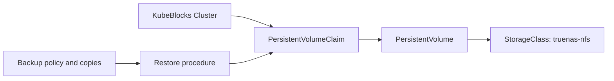

# 💾 MKP storage, backup, and recovery

Persistent storage is part of an application's reliability design, not a side effect of a database Cluster manifest.

## Storage layers



## 1. Inspect capacity before deployment

```bash
kubectl get storageclass
kubectl -n demo get pvc
kubectl -n demo describe pvc <pvc-name>
```

MTS KubeBlocks examples use:

```yaml
storageClassName: truenas-nfs
accessModes:
  - ReadWriteOnce
```

## 2. Plan retention

Define:

- recovery point objective (RPO);
- recovery time objective (RTO);
- backup frequency and retention;
- encrypted backup destination;
- who can restore;
- how a restore is tested.

## 3. Treat database policies correctly

```yaml
terminationPolicy: DoNotTerminate
```

This protects ordinary Cluster deletion. It does not protect against:

- accidental data mutation;
- application-level corruption;
- credential misuse;
- storage failure;
- deletion performed with an explicitly changed policy.

## 4. Test a non-production restore

Use a disposable namespace or application name:

```text
1. Take an approved backup.
2. Record the backup identifier and source.
3. Restore into an isolated target.
4. Validate row counts, object counts, and application reads.
5. Remove the test target under the approved retention policy.
```

Never overwrite production to prove that a restore works.

## 5. Document ownership

For every persistent service, record:

| Responsibility | Owner |
|---|---|
| StorageClass and capacity | MKP platform |
| Backup schedule and tool | Platform or service team, as agreed |
| Restore test | Service owner with platform support |
| Retention and deletion | Security/business owner |
| Recovery runbook | Service owner |

## Topic Q&A

### 1. What does a StorageClass provide?
A provisioning profile mapping a claim to supported storage.

### 2. What does a PVC request?
Capacity and access characteristics for a workload.

### 3. What does `ReadWriteOnce` mean?
The volume can be mounted read-write by a single eligible node, subject to the storage implementation.

### 4. Why test restoration?
A backup is useful only if a documented restore can recover accepted data.

### 5. Should retention be unlimited?
No. Apply business, security, and capacity requirements.

## MTS Labs Q&A

### 1. Which StorageClass appears in MTS KubeBlocks examples?
`truenas-nfs`.

### 2. Which protection policy is common on MTS data Clusters?
`DoNotTerminate`.

### 3. Does that policy replace an MTS backup?
No. It only protects deletion of the KubeBlocks Cluster resource.

### 4. Which MKP team supports storage provisioning?
The MKP platform team controls StorageClasses and backend capacity.

### 5. Who validates recovered application data?
The application/service owner, with platform support.

## Troubleshooting questions

### Why is the PVC `Pending`?
Check that `truenas-nfs` exists, capacity is available, and the claim access mode is supported.

### Why did pod replacement lose expected files?
Verify the container mounts the PVC at the application's actual data path.

### Why is storage full while requests are small?
Inspect usage inside the volume, backup/log growth, retention, and database-specific compaction.

### Why can a backup not be restored?
Test credentials, destination access, version compatibility, restore tooling, and documented target namespace.
