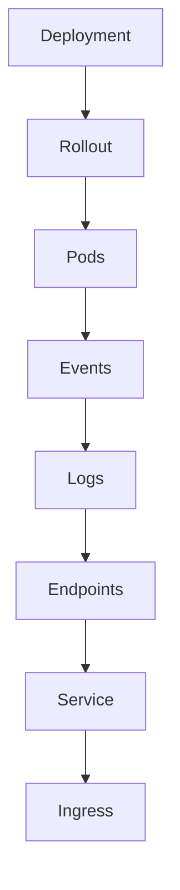

# 📊 Observe an application on MKP

Use a repeatable ladder: desired state, rollout, pods, events, logs, endpoints, and only then application-specific metrics.

## Observation ladder



## 1. Desired state

```bash
kubectl -n demo get deploy,sts,ds,svc,ingress
kubectl -n demo get deployment demo-node -o yaml
```

## 2. Rollout and pods

```bash
kubectl -n demo rollout status deployment/demo-node --timeout=180s
kubectl -n demo get pods -l app=demo-node -o wide
kubectl -n demo describe pod -l app=demo-node
```

## 3. Events and logs

```bash
kubectl -n demo get events --sort-by=.lastTimestamp
kubectl -n demo logs -l app=demo-node --all-containers --tail=200
kubectl -n demo logs -l app=demo-node -f
```

Restarted container:

```bash
kubectl -n demo logs <pod-name> -c demo-node --previous
```

## 4. Network path

```bash
kubectl -n demo get endpoints demo-node
kubectl -n demo get ingress demo-node -o wide
kubectl -n demo port-forward service/demo-node 8080:80
```

## 5. Correlate a release

Record:

- Git commit and branch;
- Jenkins build number;
- image digest;
- Spinnaker pipeline execution;
- Deployment rollout time;
- namespace and MKP context.

## Topic Q&A

### 1. Why inspect events after logs?
Events often explain scheduling, image pull, probe, and volume failures before application logs exist.

### 2. Why use labels in log commands?
Labels follow replacement pods across a rollout.

### 3. What does `--previous` show?
Logs from the container's previous terminated instance.

### 4. When should I port-forward?
When testing an internal Service without exposing it through ingress.

### 5. What correlates CI with runtime?
The immutable image digest and deployment timestamp.

## MTS Labs Q&A

### 1. Which access check is required before observing?
Connect to the MTS VPN and verify the selected MKP context.

### 2. Can OIDC login alone guarantee read permissions?
No. Namespace/cluster visibility depends on Kubernetes RBAC.

### 3. Which management hostname may be useful for tooling?
MTS DNS defines approved management domains under `mgt.<cluster>.mkp.net`.

### 4. Which image reference is auditable?
The digest in Jenkins artifacts and the deployed pod template.

### 5. Which contexts separate environments?
Development, test, and production use separate `mkp-d1-*`, `mkp-t1-*`, and `mkp-p1-*` contexts.

## Troubleshooting questions

### Why do commands return NotFound?
Verify context and namespace before the resource name.

### Why are there no logs?
Check pod state, container name, and whether the process has started.

### Why are pods ready but the Service fails?
Inspect selectors, endpoints, target ports, and ingress backend configuration.

### Why can I view the cluster but not application Secrets?
Secret read is a separate RBAC permission and should not be assumed.
