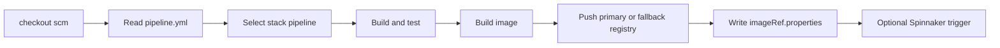

# 🧰 Build with MTS Jenkins

Welcome to the MTS Jenkins workflow. A service repository does not need a long, custom pipeline. It loads `mts-jenkins-lib` and supplies a small `pipeline.yml`.

## Pipeline flow



## Repository contract

Every demo repository contains:

```text
Jenkinsfile
pipeline.yml
Dockerfile
application source
```

The Jenkinsfile is intentionally small:

```groovy
library identifier: 'buildPipeline@master',
  retriever: modernSCM([
    $class: 'GitSCMSource',
    credentialsId: 'github-repo-token',
    remote: 'https://github.com/MagusTechSolutions/mts-jenkins-lib.git'
  ])

buildPipeline(
  configFile: 'pipeline.yml'
)
```

Use the explicit retriever when the shared library is not configured globally. If the library **is** configured globally, load it with the configured `@Library(...) _` syntax instead; do not load the same library twice.

## Required Jenkins setup

1. Create a Pipeline or Multibranch Pipeline job.
2. Point its SCM to the application repository.
3. Confirm Jenkins can run `checkout scm`.
4. Ensure the selected agent label exists.
5. Configure Docker registry credential ID `jcr-mts-2`.
6. If the shared library is private, configure its repository-read credential ID.
7. If SonarQube is enabled, pass the correct `sonarCredsId`.

> [!IMPORTANT]
> The library's current image pipelines use Jenkins credential `jcr-mts-2`. The old `docker.credsId` YAML value is deprecated and ignored.

## Stack routing

| `stack` | Agent | Default behavior |
|---|---|---|
| `java`, `java21` | `java21` | Maven wrapper, tests, Docker |
| `java17` | `java17` | Maven wrapper, tests, Docker |
| `nodejs` / `node20` | `node20` | `npm install`, `npm test`, optional build |
| `python311` | `python311` | virtual environment, editable install, pytest |
| other `python*` | `python312` | same Python pipeline |
| unknown / generic | `agent any` | optional custom build, then Docker |

## A baseline `pipeline.yml`

```yaml
app: demo-node
stack: nodejs
project: demo
artifacts:
  - 'imageRef.properties'
  - 'pipeline.properties'
```

Enable Spinnaker after its application and pipelines exist:

```yaml
spinnaker_app: demo-node

environments:
  - name: feature/
    deploy: true
    spinnaker:
      pipeline: deploy-dev
      parameters:
        namespace: demo
        appname: demo-node
  - name: develop
    deploy: true
    spinnaker:
      pipeline: deploy-dev
      parameters:
        namespace: demo
        appname: demo-node
  - name: master
    deploy: true
    spinnaker:
      pipeline: deploy-prod
      parameters:
        namespace: demo
        appname: demo-node
```

## What happens to branch names

The library replaces `/` with `_`:

```text
feature/login -> feature_login
```

It chooses:

- `mts-release` for `master` and `release*`;
- `mts-sandbox` for other branches.

## Output files

After a successful push, the pipeline writes the same digest reference to:

```text
imageRef.properties
pipeline.properties
```

Example:

```properties
IMAGE_NAME=containerregistry.mts-lab.net/mts-sandbox/demo/demo-node@sha256:REPLACE_WITH_DIGEST
```

Archive these files by listing them under `artifacts`.

## Tutorials

- [Java Spring Boot](04-jenkins-java-spring.md)
- [Python FastAPI](05-jenkins-python-fastapi.md)
- [Generic image](06-jenkins-generic-image.md)
- [Node.js](07-jenkins-node.md)

## Topic Q&A

### 1. Do I add a Docker push step?
No. The selected shared-library pipeline builds and pushes the image.

### 2. What selects the stack pipeline?
The `stack` value in the repository's root `pipeline.yml`.

### 3. Why archive image property files?
They preserve the digest Spinnaker and later audit steps should consume.

### 4. What makes a branch use the release registry path?
Branches beginning with `release` or `master` use `mts-release`; other branches use `mts-sandbox`.

### 5. How are slashes in branch names represented?
The library changes `/` to `_` for the Docker tag.

## MTS Labs Q&A

### 1. Which shared library powers these jobs?
`mts-jenkins-lib` is loaded from its Git repository and routes by `stack`.

### 2. Which registry stores MTS images?
Jenkins pushes through the private MTS JFrog registry and emits an externally routable digest reference.

### 3. Which registry credential should Jenkins use?
The current library resolves credential ID `jcr-mts-2`; `docker.credsId` is deprecated in YAML.

### 4. Which deployment system follows Jenkins?
Spinnaker deploys the baked manifest and selected immutable image to MKP.

### 5. Do all MTS Jenkins agents have every build tool?
No. Confirm the agent label and installed tools for the selected stack.

## Troubleshooting questions

### Why is `pipeline.yml` not found?
Confirm the file is committed at the repository root and `checkout scm` points to the correct branch.

### Why did Docker authentication fail?
Verify Jenkins credential `jcr-mts-2`, registry reachability, and Docker daemon insecure-registry configuration where HTTP is used.

### Why did deployment not run?
Check `spinnaker_app`, branch mapping, and the pipeline name configured in Spinnaker.

### Why is the build unstable after deployment failure?
That is the library default. Use `spinnakerFailOnError: true` only when deployment failure must fail the entire build.

