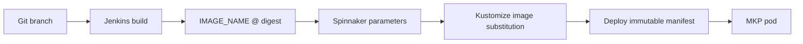

# 📦 Trace an image from Jenkins to Spinnaker

This guide explains the handoff that connects a tested build to a running MKP workload.



## 1. Verify the source reference

Archive and inspect:

```text
imageRef.properties
pipeline.properties
```

Expected shape:

```properties
IMAGE_NAME=containerregistry.mts-lab.net/mts-sandbox/demo/demo-node@sha256:...
```

## 2. Trace branch mapping

```yaml
spinnaker_app: demo-node
environments:
  - name: feature/
    deploy: true
    spinnaker:
      pipeline: deploy-dev
      parameters:
        namespace: demo
        appname: demo-node
  - name: develop
    deploy: true
    spinnaker:
      pipeline: deploy-dev
      parameters:
        namespace: demo
        appname: demo-node
  - name: master
    deploy: true
    spinnaker:
      pipeline: deploy-prod
      parameters:
        namespace: demo
        appname: demo-node
```

## 3. Confirm bake substitution

```yaml
images:
  - name: app-image
    newName: ${image}
```

Inspect the baked manifest and confirm its container image ends with `@sha256:...`.

## 4. Confirm rollout

```bash
kubectl -n demo get deployment demo-node \
  -o jsonpath='{.spec.template.spec.containers[0].image}{"\n"}'
kubectl -n demo rollout history deployment/demo-node
kubectl -n demo rollout status deployment/demo-node
```

## Topic Q&A

### 1. Why use `IMAGE_NAME` rather than rebuilding in Spinnaker?
The handoff deploys the exact tested content.

### 2. Can a digest be changed after publication?
The digest represents immutable content; a tag can move, but the digest should not.

### 3. What is the Kustomize image alias?
The base manifest uses `app-image`; the overlay substitutes `${image}`.

### 4. Which parameters identify the destination?
At minimum `image`, `namespace`, and `appname` for the demo contract.

### 5. Does Jenkins need Spinnaker enabled on every branch?
No. Branch mappings decide which configured branches trigger a deployment.

## MTS Labs Q&A

### 1. Which registry host appears in the final MTS image reference?
`containerregistry.mts-lab.net`.

### 2. Which project appears in these demos?
`demo`.

### 3. Which Spinnaker application is used?
The starter uses an application name matching the deployable app, such as `demo-node`.

### 4. Which local pipeline names do MTS examples use?
Common mappings are `deploy-dev` and `deploy-prod`.

### 5. Where is the image displayed after deployment?
In the Kubernetes Deployment pod template and Spinnaker deployment history.

## Troubleshooting questions

### Why did Spinnaker deploy an old image?
Check branch mapping, trigger properties, and the final baked manifest rather than relying on the repository tag.

### Why is `app-image` still present after baking?
`image` was not supplied or Kustomize substitution did not run for the expected overlay.

### Why did Jenkins produce a digest but Spinnaker did not run?
Check `spinnaker_app`, environment branch matching, and the configured pipeline name.

### Why is the pod using a tag after deployment?
Inspect the baked image field and fail the promotion if it is not digest-pinned.
