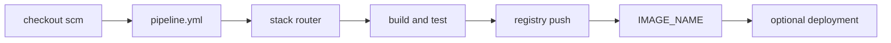

# 🛠️ Troubleshoot MTS Jenkins builds

Use the console output as a timeline: source checkout, config loading, stack selection, tests, image push, artifact storage, and optional Spinnaker execution.

## Pipeline timeline



## Diagnose from the first failed stage

### SCM checkout

```text
Verify repository URL, branch, Jenkins SCM credential, webhook, and agent network access.
```

### Pipeline config

```text
Loaded pipeline config from pipeline.yml:
```

If this line is absent, confirm `configFile` and the committed file path.

### Stack and agent

| Stack | Expected MTS agent |
|---|---|
| `java` / `java21` | `java21` |
| `java17` | `java17` |
| `nodejs` | `node20` |
| `python310` | `python310` |
| `python311` | `python311` |
| other `python...` | `python312` |
| generic/unknown | `any` |

### Image stage

The library pushes to the configured primary registry and can fall back to the local registry. A successful image stage must resolve a digest and write:

```properties
IMAGE_NAME=...@sha256:...
```

## Preserve useful evidence

```yaml
artifacts:
  - 'coverage.xml'
  - 'target/*.jar'
  - 'build/output.txt'
  - 'imageRef.properties'
  - 'pipeline.properties'
```

Do not print tokens, Secret values, kubeconfigs, or registry passwords in the console.

## Topic Q&A

### 1. Why start from the first failed stage?
Later stages often fail because an earlier file, artifact, or digest was never produced.

### 2. Should a rerun be the first action?
No. Capture the failing command and exit code before retrying.

### 3. What proves the image is publishable?
A successful digest resolution and archived `IMAGE_NAME`, not only a successful Docker build.

### 4. Why preserve coverage and test output?
It distinguishes product defects from packaging or agent problems.

### 5. When is a custom build command appropriate?
When the standard stack command does not match the repository's actual build contract.

## MTS Labs Q&A

### 1. Which Jenkins library selects the pipeline?
`mts-jenkins-lib`.

### 2. Which registry credential does the current pipeline resolve?
`jcr-mts-2`.

### 3. Which old Docker YAML setting should be ignored?
`docker.credsId`; the library documentation marks it deprecated.

### 4. Why may HTTP registry pushes require extra setup?
The Jenkins Docker daemon may need the MTS registry host in `insecure-registries`.

### 5. Why can a deployment failure produce an unstable build?
That is the default shared-library behavior unless `spinnakerFailOnError: true` is configured.

## Troubleshooting questions

### Why does the job wait forever for an agent?
Verify the exact agent label exists and is online.

### Why did the Docker push succeed but deployment fail?
Separate registry success from Spinnaker account, application, pipeline, and parameter errors.

### Why is `IMAGE_NAME` missing?
Inspect the push/digest-resolution step and its error output before checking downstream deployment.

### Why is the shared library checkout denied?
Verify the repository-read credential attached to the explicit SCM retriever.
