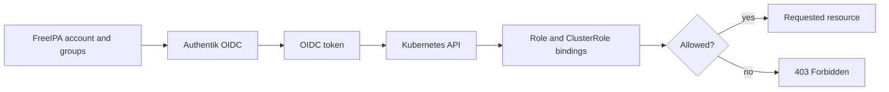

# 🔐 MKP security and RBAC

MKP separates identity, authentication, and authorization so each layer can be understood and audited.



## Check your effective identity

```bash
kubectl auth whoami
kubectl auth can-i get pods --namespace demo
kubectl auth can-i create deployments --namespace demo
kubectl auth can-i get secrets --namespace demo
```

These commands test what the current token may do; a successful Authentik login is not a blanket grant.

## How RBAC maps in MKP

- **FreeIPA:** source of MTS accounts and group information.
- **Authentik:** OIDC provider and Kubernetes token issuer.
- **OIDC claims:** carry identity and group information.
- **Kubernetes bindings:** connect verified identities/groups to Roles or ClusterRoles.

Do not assume an old or documented group name maps to permissions. Verify both the OIDC claim and the binding.

## Least-privilege habits

1. Request access to the smallest required namespace.
2. Avoid `cluster-admin` for routine deployment.
3. Use `kubectl auth can-i` before reporting permission failures.
4. Store application secrets in Kubernetes Secrets or the approved secret platform.
5. Never commit kubeconfigs, registry credentials, OIDC tokens, or decoded secrets.
6. Do not print Secret values in CI logs or shared terminal recordings.

## Inspect Secrets safely

List Secret names:

```bash
kubectl -n demo get secrets
```

Inspect only keys:

```bash
kubectl -n demo get secret demo-secret \
  -o jsonpath='{.data}' | jq 'keys'
```

Avoid:

```bash
kubectl -n demo get secret demo-secret -o yaml
```

when the terminal is shared, recorded, or included in support output.

## API certificate note

The supplied kubeconfig currently uses `insecure-skip-tls-verify: true` for the Kubernetes API. Treat that configuration as an MTS environment limitation and use it only over the trusted VPN. Prefer a platform-issued CA-verified kubeconfig when available.

## Topic Q&A

### 1. What is authentication?
Proof of identity, performed by Authentik OIDC for the supplied MKP kubeconfig.

### 2. What is authorization?
Kubernetes RBAC's decision about what the authenticated identity may do.

### 3. What is a Role?
A namespaced list of allowed API operations.

### 4. What is a ClusterRole?
A reusable permission definition that may apply cluster-wide or through namespaced bindings.

### 5. Why test permissions with `can-i`?
It checks the effective authorization path instead of relying on group-name assumptions.

## MTS Labs Q&A

### 1. Where do MKP users originate?
FreeIPA maintains MTS account and group data.

### 2. Which service provides Kubernetes OIDC tokens?
Authentik.

### 3. Does FreeIPA membership automatically prove a Kubernetes permission?
No. Verify the OIDC claim mapping and Kubernetes binding.

### 4. Why is the VPN still required after authentication?
The private API, issuer, DNS, and cluster endpoints remain reachable only over the trusted MTS network path.

### 5. Should I routinely request `cluster-admin`?
No. Request least privilege for the required namespace and operation.

## Troubleshooting questions

### Why is my token valid but access is Forbidden?
Check RBAC bindings and claims with `kubectl auth whoami` and targeted `can-i` commands.

### Why can I access development but not production?
Production has a separate cluster and RBAC configuration; an approved Spinnaker gate does not automatically grant `kubectl` access.

### Why is Secret retrieval denied?
Secret read permission is sensitive and commonly excluded from developer roles.

### Why does the API warn about certificate verification?
The supplied kubeconfig skips API certificate verification. Use it only on the MTS VPN and request a CA-verified config when available.
