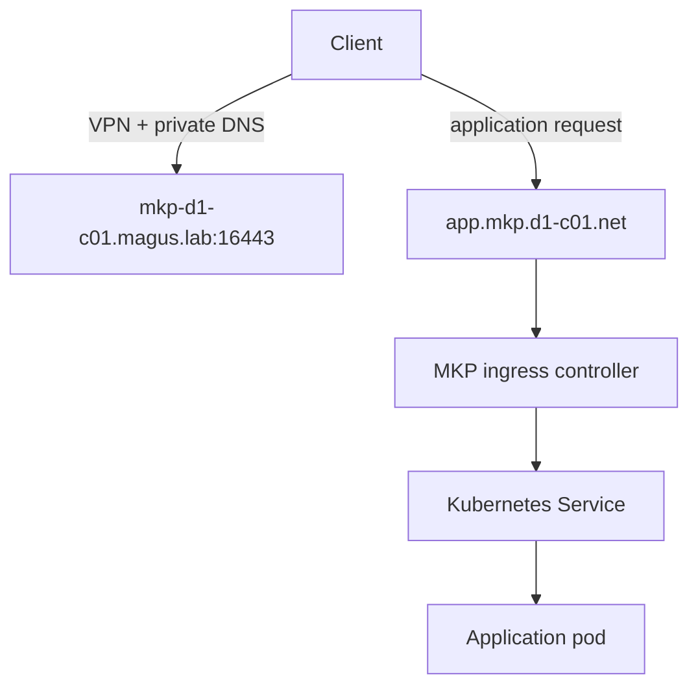

# 🌐 MKP DNS and ingress

This guide separates the private names used for Kubernetes administration from the application names used by MTS ingress.

## Two DNS domains, two jobs



### Kubernetes API

```text
mkp-d1-c01.magus.lab:16443
```

Used by `kubectl`; reachable through the MTS VPN.

### Application ingress

Examples follow environment and cluster-specific patterns:

```text
<app>.mkp.d1-c01.net
<app>.mkp.t1-c01.net
<app>.mkp.p1-c01.net
```

Management and internal service branches also include `mgt.<cluster>.mkp.net` and `svc.<cluster>.mkp.net`.

## Choose a hostname

1. Identify the target environment: `d1`, `t1`, or `p1`.
2. Confirm the cluster node used by that environment.
3. Reserve an application name under the approved wildcard.
4. Confirm the ingress class installed in the cluster.
5. Point the ingress backend at an existing Service and port.

## Example

```yaml
apiVersion: networking.k8s.io/v1
kind: Ingress
metadata:
  name: demo-node
  namespace: demo
spec:
  ingressClassName: public
  rules:
    - host: demo-node.mkp.d1-c01.net
      http:
        paths:
          - path: /
            pathType: Prefix
            backend:
              service:
                name: demo-node
                port:
                  number: 80
```

## Verify ingress

```bash
kubectl -n demo get ingress demo-node -o wide
kubectl -n demo describe ingress demo-node
kubectl -n demo get service demo-node
kubectl -n demo get endpoints demo-node
nslookup demo-node.mkp.d1-c01.net
curl -vk https://demo-node.mkp.d1-c01.net/
```

## Certificates

MKP uses FreeIPA-backed internal certificate automation through cert-manager for approved internal ingress names. Do not paste private certificate keys into application repositories.

## Topic Q&A

### 1. What does an Ingress configure?
HTTP/HTTPS host and path routing to Kubernetes Services.

### 2. Does an Ingress replace a Service?
No. The Ingress backend still targets a Service.

### 3. What does the ingress controller do?
It reads Ingress resources and configures the HTTP routing layer.

### 4. Can one Ingress expose several hostnames?
Yes, when the platform policy and certificate cover every host.

### 5. Does NodePort provide host-based routing?
No. NodePort exposes a port; ingress provides DNS host/path routing.

## MTS Labs Q&A

### 1. Which names are used for the Kubernetes API?
Private `mkp-<environment>-c<node>.magus.lab` names on port `16443`.

### 2. Which names are used for development applications?
The documented `<app>.mkp.d1-c01.net` pattern for the D1 cluster.

### 3. Is MTS application DNS public?
It is private/internal DNS intended for the approved MTS network and trust model.

### 4. Which ingress class appears in MTS examples?
`public`.

### 5. How are internal certificates issued?
Cert-manager integrates with the FreeIPA-backed internal CA/ACME flow.

## Troubleshooting questions

### Why does the hostname not resolve?
Confirm the VPN, internal DNS, environment spelling, and cluster suffix.

### Why is the ingress status present but the app returns 503?
Check that the Service has endpoints and that the backend port matches `targetPort`.

### Why does TLS fail?
Confirm the certificate covers the selected host and the client trusts the internal FreeIPA CA.

### Why is the API URL being used as an application host?
Keep `magus.lab:16443` for `kubectl`; use MKP ingress application domains for HTTP traffic.
