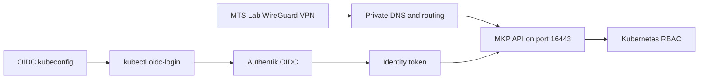

# 🔑 Connect to MKP with VPN and OIDC

Welcome to MKP access! This page walks from an MTS account to an authenticated `kubectl` session.

## Access flow



## 1. Prerequisites

You need:

- an active MTS/FreeIPA account;
- Git and `kubectl`;
- Krew;
- the Krew `oidc-login` plugin;
- the supplied `kubectl-config`;
- the MTS Lab WireGuard VPN.

> [!IMPORTANT]
> The required plugin is Krew's `oidc-login`. It is not the unrelated Azure `kubelogin` executable.

## 2. Install `oidc-login`

On every supported operating system, first install `kubectl` and Git. Install Krew, open a new shell, then run:

```bash
kubectl krew install oidc-login
kubectl krew version
kubectl oidc-login --help
```

On Windows, Krew normally places plugins under:

```text
%USERPROFILE%\.krew\bin
```

On macOS/Linux, use:

```text
${KREW_ROOT:-$HOME/.krew}/bin
```

## 3. Connect the VPN

Use the MTS VPN portal and the WireGuard profile assigned to your account. The VPN supplies both routing and internal DNS for:

- MKP API FQDNs under `magus.lab`;
- `authentik.mts-lab.net`;
- internal application and service names.

## 4. Configure `kubectl`

Save the platform-supplied `kubectl-config` as `~/.kube/config`, or keep it separate:

```bash
export KUBECONFIG="$HOME/path/to/kubectl-config"
```

PowerShell:

```powershell
$env:KUBECONFIG = "$HOME\path\to\kubectl-config"
```

Do not edit the OIDC client ID or issuer unless the platform team issues an updated kubeconfig.

## 5. Select development

```bash
kubectl config get-contexts
kubectl config use-context mkp-d1-c01
kubectl config current-context
```

## 6. Authenticate

```bash
kubectl auth whoami
kubectl auth can-i get pods --namespace demo
kubectl get namespaces
```

The first protected request starts the Authentik browser flow. Kubernetes then authorizes the resulting identity with RBAC.

## 7. Validate private DNS

```bash
nslookup mkp-d1-c01.magus.lab
nslookup authentik.mts-lab.net
```

Both names must resolve while the MTS VPN is connected.

## Topic Q&A

### 1. What does a kubeconfig contain?
Cluster endpoints, contexts, and authentication client configuration.

### 2. What does OIDC return to `kubectl`?
An identity token that Kubernetes validates for API requests.

### 3. Does DNS authenticate the user?
No. DNS resolves names; Authentik authenticates; RBAC authorizes.

### 4. Where is the token stored?
The `oidc-login` plugin caches tokens locally according to its configuration.

### 5. Can I bypass the VPN with a public route?
No. Use the supplied private MKP access path.

## MTS Labs Q&A

### 1. Which identity directory holds MTS accounts?
FreeIPA (LDAP).

### 2. Which provider issues MKP OIDC tokens?
Authentik at `authentik.mts-lab.net`.

### 3. Which context is the normal default?
`mkp-d1-c01`.

### 4. Which port does the Kubernetes API use?
`16443`.

### 5. Which VPN implementation is used?
WireGuard through the MTS Lab VPN onboarding flow.

## Troubleshooting questions

### Why is `kubectl oidc-login` unknown?
Install it through Krew and add Krew's bin directory to the current shell's `PATH`.

### Why does the browser login loop continue?
Return to the terminal, finish the local callback, verify VPN/DNS, and retry the Kubernetes command.

### Why is `Forbidden` returned after login?
Use `kubectl auth whoami` and `kubectl auth can-i`; successful authentication does not grant every RBAC permission.

### Why do both DNS and API connections fail?
Reconnect the MTS VPN and check its profile or network adapter before debugging Kubernetes.
