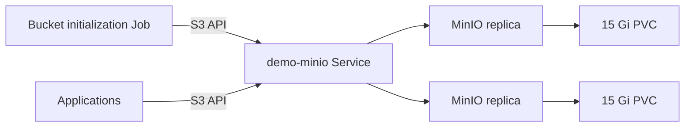

# 🪣 MinIO S3 storage with KubeBlocks

This demo provisions a two-replica MinIO component with KubeBlocks and initializes multiple S3 buckets using a Kubernetes Job.

> **Open the starter in a browser IDE:** [KubeBlocks source browser](code-browser/kubeblocks.md). You can expand, copy, and save the MinIO Cluster, Service, and bucket Job.

## Architecture



## 1. Confirm the MinIO definition

```bash
kubectl api-resources | grep -i kubeblocks
kubectl get clusterversion,componentversion,componentdefinition 2>/dev/null | grep -i minio
```

The exact component name is cluster-dependent. The MTS S3 reference uses:

```yaml
componentDef: minio
```

## 2. Deploy MinIO

```yaml
apiVersion: apps.kubeblocks.io/v1
kind: Cluster
metadata:
  name: demo-minio
  namespace: demo
spec:
  terminationPolicy: DoNotTerminate
  componentSpecs:
    - name: minio
      componentDef: minio
      replicas: 2
      resources:
        requests:
          cpu: 100m
          memory: 256Mi
        limits:
          cpu: 500m
          memory: 512Mi
      volumeClaimTemplates:
        - name: data
          spec:
            storageClassName: truenas-nfs
            accessModes:
              - ReadWriteOnce
            resources:
              requests:
                storage: 15Gi
```

## 3. Expose the API internally

MTS workloads select MinIO pods with:

```yaml
selector:
  app.kubernetes.io/instance: demo-minio
  apps.kubeblocks.io/component-name: minio
```

Create:

```yaml
apiVersion: v1
kind: Service
metadata:
  name: demo-minio
  namespace: demo
spec:
  type: NodePort
  selector:
    app.kubernetes.io/instance: demo-minio
    apps.kubeblocks.io/component-name: minio
  ports:
    - name: s3-api
      port: 9000
      targetPort: 9000
```

Applications inside MKP should use:

```text
http://demo-minio:9000
```

External MTS clients use the shared database host with the MinIO Service's NodePort:

```text
http://mts-db.magus.lab:<minio-nodeport>
```

The hostname resolves to `192.168.1.241` in current MTS deployment configuration. The implemented MTS S3 initialization job uses:

```text
http://192.168.1.241:30744
```

Prefer `mts-db.magus.lab:30744` for this existing endpoint, and read the NodePort from the Service for a newly created demo:

```bash
kubectl -n demo get service demo-minio \
  -o jsonpath='{.spec.ports[?(@.name=="s3-api")].nodePort}{"\n"}'
```

## 4. Discover the generated root credential secret

The MTS bucket job uses this naming pattern:

```text
<cluster>-minio-account-root
```

For this demo:

```text
demo-minio-minio-account-root
```

Confirm it exists:

```bash
kubectl -n demo get secrets | grep demo-minio
```

> [!NOTE]
> If the installed MinIO KubeBlocks addon creates a different secret name, use its actual secret rather than copying this name blindly.

## 5. Create multiple buckets

```yaml
apiVersion: batch/v1
kind: Job
metadata:
  name: demo-minio-buckets
  namespace: demo
spec:
  backoffLimit: 10
  template:
    spec:
      restartPolicy: OnFailure
      containers:
        - name: init
          image: public.ecr.aws/aws-cli/aws-cli:latest
          env:
            - name: AWS_ACCESS_KEY_ID
              valueFrom:
                secretKeyRef:
                  name: demo-minio-minio-account-root
                  key: username
            - name: AWS_SECRET_ACCESS_KEY
              valueFrom:
                secretKeyRef:
                  name: demo-minio-minio-account-root
                  key: password
            - name: AWS_DEFAULT_REGION
              value: us-east-1
          command: ["/bin/sh", "-c"]
          args:
            - |
              set -eu
              cat > /tmp/aws-config <<'EOF'
              [default]
              s3 =
                  addressing_style = path
              EOF
              export AWS_CONFIG_FILE=/tmp/aws-config
              endpoint=http://demo-minio:9000
              until aws --endpoint-url "$endpoint" s3api list-buckets >/dev/null; do
                sleep 5
              done
              for bucket in demo-uploads demo-assets demo-backups; do
                aws --endpoint-url "$endpoint" s3api head-bucket --bucket "$bucket" \
                  2>/dev/null || \
                aws --endpoint-url "$endpoint" s3api create-bucket --bucket "$bucket"
              done
```

Apply and inspect:

```bash
kubectl -n demo apply -f minio-cluster.yml
kubectl -n demo apply -f minio-service.yml
kubectl -n demo apply -f bucket-job.yml
kubectl -n demo wait --for=condition=complete job/demo-minio-buckets --timeout=300s
kubectl -n demo logs job/demo-minio-buckets
```

## 6. Verify buckets

Run a client using the same secret:

```bash
kubectl -n demo exec -it deploy/REPLACE_WITH_APP -- \
  sh -c 'env | grep -E "^AWS_(ACCESS_KEY_ID|SECRET_ACCESS_KEY)$" | sed "s/=.*/=<redacted>/"'
```

Use the AWS CLI from a controlled environment with injected secret values:

```bash
aws --endpoint-url http://demo-minio:9000 s3api list-buckets
```

## Topic Q&A

### 1. Is MinIO compatible with S3 clients?
Yes. The demo uses S3-compatible AWS CLI calls and path-style addressing.

### 2. Why initialize buckets with a Job?
It makes repeatable creation idempotent through `head-bucket` checks.

### 3. Does MinIO supply bucket permissions?
Not from this manifest. Configure policies, lifecycle, and access control separately.

### 4. Why use two replicas?
It follows the MTS S3 reference and demonstrates multiple MinIO members.

### 5. Should the Service be internet-public?
No. Expose only through an approved private ingress, NodePort, or network path.

## MTS Labs Q&A

### 1. Which StorageClass does MTS MinIO use?
`truenas-nfs`.

### 2. What is the shared MTS database/S3 host?
`mts-db.magus.lab`, currently backed by `192.168.1.241`.

### 3. What existing MTS S3 endpoint is implemented?
`http://192.168.1.241:30744`; prefer the DNS form `http://mts-db.magus.lab:30744` where supported.

### 4. Which secret pattern does the MTS bucket Job use?
`<cluster>-minio-account-root`, with `username` and `password` keys.

### 5. Which labels select MinIO members?
`app.kubernetes.io/instance` and `apps.kubeblocks.io/component-name: minio`.

## Troubleshooting questions

### Why does the bucket Job never become ready?
Check the MinIO Cluster, Service endpoints, generated root Secret, and Job logs.

### Why does S3 signing fail?
Use path-style addressing and verify `AWS_ACCESS_KEY_ID`, secret, endpoint, and region.

### Why can the Job resolve MinIO but not list buckets?
Wait for MinIO readiness, verify port `9000`, and inspect the Secret key values without printing them to logs.

### Why does the external endpoint fail?
Confirm VPN/DNS, the Service's actual NodePort, and approved network exposure before using `mts-db.magus.lab`.

