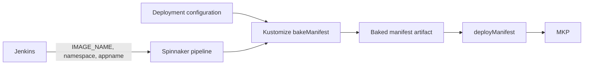

# 🚢 Spinnaker: bake and deploy to MKP

Jenkins verifies and publishes an application image. Spinnaker deploys that immutable image together with the selected Kubernetes configuration.

## Delivery contract



The MTS S3 reference uses two stages:

1. `bakeManifest` with `KUSTOMIZE4`
2. `deployManifest` for the Kubernetes provider

A complete copyable template is available in [examples/spinnaker](../examples/spinnaker/).

> **Open the starter in a browser IDE:** [Spinnaker source browser](code-browser/spinnaker.md). Expand, copy, or save the pipeline and every Kustomize file.

## 1. Structure the deployment configuration

```text
demo-app/
  base/
    deployment.yml
    service.yml
    kustomization.yml
  overlays/
    dev/
      kustomization.yml
```

The MTS convention is:

- the base Deployment uses image name `app-image`;
- the overlay maps `app-image` to `${image}`;
- the overlay namespace is `${namespace}`;
- Spinnaker supplies `image`, `namespace`, and `appname`.

```yaml
apiVersion: kustomize.config.k8s.io/v1beta1
kind: Kustomization
namespace: ${namespace}
resources:
  - ../../base
images:
  - name: app-image
    newName: ${image}
```

## 2. Match the Jenkins trigger

Application `pipeline.yml`:

```yaml
spinnaker_app: demo-node
environments:
  - name: develop
    deploy: true
    spinnaker:
      pipeline: deploy-dev
      parameters:
        namespace: demo
        appname: demo-node
  - name: master
    deploy: true
    spinnaker:
      pipeline: deploy-prod
      parameters:
        namespace: demo
        appname: demo-node
```

The Jenkins shared library provides the digest-based `IMAGE_NAME`. The pipeline must connect that value to Spinnaker's `image` parameter.

## 3. Paste the complete pipeline JSON

In Spinnaker, open **Pipelines → Configure → JSON editor**, replace the pipeline JSON with the block below, edit the `REPLACE_WITH_*` values, and save it.

> [!IMPORTANT]
> This JSON is complete, but it is intentionally not cluster-specific. Replace the Git artifact account, deployment repository URL, Kubernetes account, application name, and expected-artifact ID before saving it in an MTS environment.

```json
{
  "application": "demo",
  "name": "Deploy demo application",
  "description": "Bake and deploy the demo application with Kustomize.",
  "keepWaitingPipelines": false,
  "limitConcurrent": true,
  "spelEvaluator": "v4",
  "parameterConfig": [
    {
      "name": "namespace",
      "label": "Kubernetes namespace",
      "description": "Namespace receiving the demo application.",
      "default": "demo",
      "required": true
    },
    {
      "name": "appname",
      "label": "Application name",
      "description": "Name inserted into deployment manifests.",
      "default": "demo-node",
      "required": true
    },
    {
      "name": "image",
      "label": "Immutable image reference",
      "description": "Digest-pinned image supplied by Jenkins.",
      "default": "",
      "required": true
    }
  ],
  "stages": [
    {
      "name": "Bake demo manifests",
      "type": "bakeManifest",
      "refId": "bake",
      "requisiteStageRefIds": [],
      "templateRenderer": "KUSTOMIZE4",
      "kustomizeFilePath": "demo-app/overlays/dev/kustomization.yml",
      "outputName": "demo-baked-manifests",
      "namespace": "${parameters.namespace}",
      "evaluateOverrideExpressions": true,
      "inputArtifact": {
        "account": "REPLACE_WITH_GIT_ARTIFACT_ACCOUNT",
        "id": null,
        "artifact": {
          "artifactAccount": "REPLACE_WITH_GIT_ARTIFACT_ACCOUNT",
          "name": "deployment-configurations",
          "reference": "REPLACE_WITH_DEPLOYMENT_REPOSITORY_URL",
          "type": "git/repo",
          "version": "main"
        }
      },
      "expectedArtifacts": [
        {
          "defaultArtifact": {
            "customKind": false,
            "id": "REPLACE_WITH_EXPECTED_ARTIFACT_ID",
            "name": "demo-baked-manifests",
            "type": "embedded/base64"
          },
          "displayName": "Demo baked manifests",
          "id": "REPLACE_WITH_EXPECTED_ARTIFACT_ID",
          "matchArtifact": {
            "id": "REPLACE_WITH_EXPECTED_ARTIFACT_ID",
            "name": "demo-baked-manifests",
            "type": "embedded/base64"
          },
          "useDefaultArtifact": false,
          "usePriorArtifact": false
        }
      ]
    },
    {
      "name": "Deploy demo manifests",
      "type": "deployManifest",
      "refId": "deploy",
      "requisiteStageRefIds": [
        "bake"
      ],
      "cloudProvider": "kubernetes",
      "account": "REPLACE_WITH_KUBERNETES_ACCOUNT",
      "source": "artifact",
      "manifestArtifactId": "REPLACE_WITH_EXPECTED_ARTIFACT_ID",
      "manifestArtifactAccount": "embedded-artifact",
      "requiredArtifactIds": [],
      "requiredArtifacts": [],
      "skipExpressionEvaluation": false
    }
  ],
  "triggers": [],
  "notifications": [],
  "parallel": false
}
```

The same value must appear in all three `REPLACE_WITH_EXPECTED_ARTIFACT_ID` locations. A convenient identifier is a newly generated UUID, but Spinnaker's UI can also generate the expected artifact and fill this relationship.

> [!IMPORTANT]
> `REPLACE_WITH_GIT_ARTIFACT_ACCOUNT` and `REPLACE_WITH_KUBERNETES_ACCOUNT` are Spinnaker configuration names supplied by the MTS administrator. Do not guess or embed credentials.

## 4. Preview the bake locally

Replace the Spinnaker expressions with concrete values in a disposable copy:

```bash
export namespace=demo
export appname=demo-node
export image='containerregistry.mts-lab.net/mts-sandbox/demo/demo-node@sha256:REPLACE'

kubectl kustomize examples/spinnaker/demo-app/overlays/dev
```

If local Kustomize does not evaluate `$...` expressions automatically, render the same substitutions through the command or template tool used by your Spinnaker environment.

## 5. Verify deployment

```bash
kubectl -n demo get deployment,service,pods
kubectl -n demo rollout status deployment/demo-node
kubectl -n demo logs -l app=demo-node --tail=100
kubectl -n demo get events --sort-by=.lastTimestamp
```

## Troubleshooting

| Stage | Symptom | First check |
|---|---|---|
| Artifact | repository cannot be fetched | Git artifact account and repository version |
| Bake | unresolved variable | `image`, `namespace`, and `appname` parameters |
| Bake | invalid Kustomization | paths, resource kinds, and Kustomize version |
| Deploy | forbidden | Spinnaker Kubernetes account RBAC |
| Runtime | rollout timeout | image pull, probes, logs, and events |

## Topic Q&A

### 1. Does `${namespace}` come from the shell?
No. Spinnaker evaluates the pipeline expression during baking.

### 2. Why use Kustomize overlays?
They reuse one base while varying image, namespace, environment configuration, and patches.

### 3. What links the bake and deploy stages?
A matching expected-artifact ID.

### 4. Why deploy a digest rather than a tag?
The digest identifies immutable image content.

### 5. Should development and production share one pipeline?
They may share a base, but normally use separate pipeline gates and overlays.

## MTS Labs Q&A

### 1. Which template renderer is used by the MTS reference?
`KUSTOMIZE4`.

### 2. Which account names must I obtain from the administrator?
The Spinnaker Git artifact account and Kubernetes account.

### 3. How does production receive stricter protection?
MKP production is expected to use separate Spinnaker gating and approval.

### 4. Which value identifies the target MKP namespace?
Jenkins or the pipeline supplies the `namespace` parameter.

### 5. Where do deployment files normally live?
In an MTS deployment-configuration repository consumed as a Git/repo artifact.

## Troubleshooting questions

### Why is the artifact account rejected?
Use the exact Spinnaker account configured by the platform team; it is not a Jenkins credential.

### Why is `${image}` still present after baking?
Confirm Jenkins or Spinnaker supplied `image` and expression evaluation is enabled.

### Why does deploy report forbidden?
Inspect the Spinnaker Kubernetes account's RBAC for the target cluster and namespace.

### Why does the pipeline bake successfully but rollout time out?
Inspect the resulting Deployment, image pull events, probes, and application logs in MKP.
