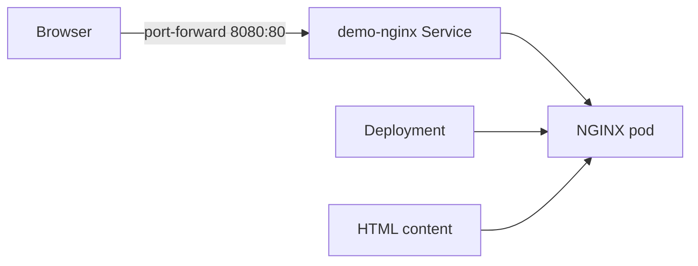

# 🌐 Deploy a static NGINX site on MKP

This is the quickest way to verify that your MKP access, namespace, deployment, Service, and port-forwarding work together.

## You will create



Use the copyable files in [examples/nginx](https://github.com/MagusTechSolutions/mts-docs-demos/tree/master/examples/nginx).

> **Prefer a browser IDE?** Open the [NGINX source browser](code-browser/nginx.md) to expand, copy, and save every starter file without leaving the tutorial.

## 1. Confirm your destination

```bash
kubectl config current-context
kubectl cluster-info
kubectl get namespace demo
```

If the namespace is missing and you are allowed to create it:

```bash
kubectl create namespace demo
```

## 2. Apply the static content

```bash
kubectl -n demo apply -f examples/nginx/configmap.yml
kubectl -n demo apply -f examples/nginx/deployment.yml
kubectl -n demo apply -f examples/nginx/service.yml
```

## 3. Wait for readiness

```bash
kubectl -n demo rollout status deployment/demo-nginx
kubectl -n demo get pods -l app=demo-nginx
kubectl -n demo get endpoints demo-nginx
```

## 4. Open the site locally

```bash
kubectl -n demo port-forward service/demo-nginx 8080:80
```

Open `http://localhost:8080`.

## 5. Inspect it

```bash
kubectl -n demo logs -l app=demo-nginx
kubectl -n demo exec deploy/demo-nginx -- nginx -T
```

## 6. Update the page

Edit the `index.html` entry in [configmap.yml](https://github.com/MagusTechSolutions/mts-docs-demos/blob/master/examples/nginx/configmap.yml), then:

```bash
kubectl -n demo apply -f examples/nginx/configmap.yml
kubectl -n demo rollout restart deployment/demo-nginx
kubectl -n demo rollout status deployment/demo-nginx
```

## 7. Clean up

```bash
kubectl -n demo delete -f examples/nginx
```

## Topic Q&A

### 1. Why use a ConfigMap for HTML?
It keeps the exercise small and demonstrates mounted configuration.

### 2. Why does NGINX have readiness and liveness probes?
Readiness controls traffic; liveness lets Kubernetes replace an unhealthy container.

### 3. When should static content become an image?
Use an image for production so the delivered content is versioned and immutable.

### 4. Why is the Service `ClusterIP`?
It is reachable inside MKP and supports local port-forwarding without public exposure.

### 5. What deletes with the cleanup command?
It deletes only objects represented by files in the NGINX example directory.

## MTS Labs Q&A

### 1. Do I need the VPN to deploy this?
Yes. Connect to the MTS Lab VPN before resolving or contacting private MKP endpoints.

### 2. Which development cluster should I use first?
The supplied kubeconfig normally defaults to `mkp-d1-c01`.

### 3. How would I publish this through MKP ingress?
Use an approved hostname under the environment's MKP DNS hierarchy, such as `<app>.mkp.d1-c01.net`, and the installed ingress class.

### 4. Who grants access to the `demo` namespace?
The MKP administrator/configuration defines OIDC group-to-RBAC bindings. Verify access with `kubectl auth can-i`.

### 5. Is ingress DNS the same as the Kubernetes API?
No. API access uses `mkp-...magus.lab:16443`; application ingress uses MKP application domains.

## Troubleshooting questions

### Why are the pods `Pending`?
Run `kubectl describe pod` and inspect scheduling, resources, image pull, and volume events.

### Why does the Service have no endpoints?
Compare the Service selector with pod labels: `kubectl get endpoints demo-nginx` and `kubectl get pods --show-labels`.

### Why did the page not update?
Reapply the ConfigMap, restart the Deployment, and verify the mounted `index.html`.

### Why does port-forward connect but the page time out?
Check pod readiness and target port mapping before repeating `kubectl port-forward`.

