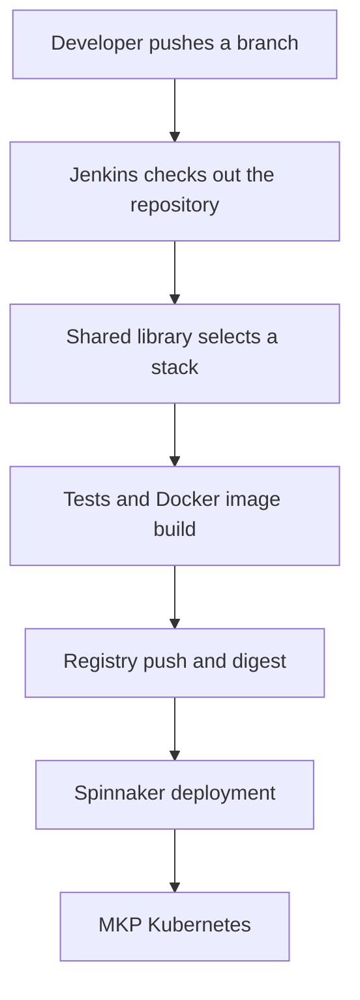

# 🚀 Welcome to the MTS Application ToolSuite

Welcome aboard! This collection shows one repeatable route from source code to a running application on MTS Labs Kubernetes Platform (MKP).

## MKP at a glance

MKP is Magus Tech Solutions' opinionated MicroK8s platform running on Ubuntu LTS machines. Its integrated path is:

| Layer | MTS platform choice |
|---|---|
| Account directory | FreeIPA (LDAP) |
| Kubernetes authentication | Authentik OIDC through `kubectl oidc-login` |
| Source and triggers | GitHub |
| Continuous integration | Jenkins |
| Private images | JFrog at `containerregistry.magus.lab` |
| Continuous deployment | Spinnaker |
| Runtime | MicroK8s |

Authentication answers **who you are**. Kubernetes RBAC answers **what you may do**. A successful Authentik login does not guarantee access to every namespace or cluster.

## What you will build



The four example repositories cover:

1. Java Spring Boot
2. Python FastAPI
3. A generic image with custom pre-build commands
4. Node.js

All examples use the new `demo` project space:

```yaml
project: demo
```

## Choose a learning order

| If you want to… | Start here |
|---|---|
| Learn MKP access and commands | [Kubernetes contexts](18-kubernetes-contexts.md) |
| Deploy a first workload without a pipeline | [NGINX static site](17-nginx-static-site.md) |
| Build an application image | [Jenkins getting started](16-jenkins-getting-started.md) |
| Deploy an image through Spinnaker | [Spinnaker and Kubernetes](11-spinnaker-kubernetes.md) |
| Add persistent data | [PostgreSQL](10-kubeblocks-databases.md), [Redis](09-kubeblocks-redis.md) |
| Add S3-compatible storage | [MinIO](08-kubeblocks-minio.md) |

## Important terms

### Context

A Kubernetes **context** selects a cluster, user, and namespace combination in your kubeconfig.

### Image digest

An **image digest** identifies exact image content:

```text
containerregistry.mts-lab.net/mts-sandbox/demo/demo-node@sha256:...
```

Deploying a digest is safer than relying on a mutable tag.

### Project

The MTS Jenkins library uses `project` in the image path. For these demos:

```text
mts-sandbox/demo/<app>
```

### Application

`app` is the unique service name. It becomes part of the image path and is commonly used as the Spinnaker application name in existing MTS pipelines.

## Before starting

Ask an administrator for:

- an MKP kubeconfig and the expected context name;
- an active FreeIPA/MTS account and access to the MTS Lab WireGuard VPN;
- `kubectl`, Krew, and the `oidc-login` plugin;
- Jenkins access and a Pipeline or Multibranch Pipeline job;
- the MTS shared-library repository access credential, if that repository is private;
- the installed Kubernetes StorageClass and KubeBlocks component definitions;
- the Spinnaker Git artifact account and Kubernetes account names.

Connect to the MTS Lab VPN before expecting private cluster and identity hostnames to resolve. The supplied kubeconfig normally defaults to `mkp-d1-c01`.

## Topic Q&A

### 1. Do I need every tool for the first demo?
No. Start with `kubectl`, the VPN, the OIDC plugin, and kubeconfig.

### 2. Why use an immutable image digest?
It identifies exact image content and prevents a mutable tag from changing between approval and deployment.

### 3. What does a Kubernetes context select?
It combines a cluster endpoint and identity; its configuration may also provide a default namespace.

### 4. Is `project` the same as a namespace?
No. `project` organizes the Jenkins image path; a namespace is a Kubernetes isolation and RBAC boundary.

### 5. Why separate Jenkins and Spinnaker?
Jenkins verifies and publishes images. Spinnaker bakes and deploys approved Kubernetes configuration.

## MTS Labs Q&A

### 1. Which Kubernetes distribution runs MKP?
MKP uses MicroK8s on Ubuntu LTS systems.

### 2. How is my MKP identity created and used?
FreeIPA holds MTS accounts and groups; Authentik issues OIDC tokens used by Kubernetes clients.

### 3. Which registry receives MTS images?
The MTS JFrog-facing image registry is `containerregistry.magus.lab`, with the Jenkins library producing an external reference under `containerregistry.mts-lab.net`.

### 4. Why must I connect to the VPN first?
MKP cluster API names, internal DNS, Authentik, registry endpoints, and application ingress names are on the private MTS network.

### 5. Which context should I start with?
The supplied config defaults to development context `mkp-d1-c01`; select test or production only when your task requires it.

## Troubleshooting questions

### Why can `kubectl` not resolve `mkp-d1-c01.magus.lab`?
Confirm the MTS VPN is connected, then test `nslookup mkp-d1-c01.magus.lab` and `nslookup authentik.mts-lab.net`.

### Why did Authentik sign-in succeed but Kubernetes still returned Forbidden?
Authentication succeeded, but RBAC denied the operation. Run `kubectl auth whoami` and `kubectl auth can-i <verb> <resource> -n <namespace>`.

### Why does `kubectl oidc-login --help` fail?
The unrelated Azure `kubelogin` is not the required plugin. Install Krew's `oidc-login` and ensure `%USERPROFILE%\.krew\bin` is on `PATH`.

